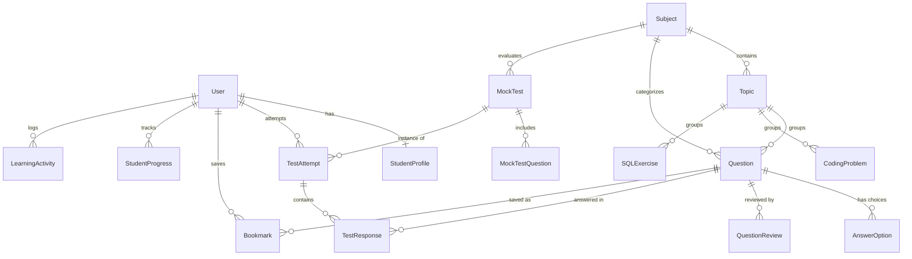

# DEEPAK INTERVIEW HUB — Database Schema & Data Models

**Database Engine:** PostgreSQL (Production) / SQLite3 (Development)  
**ORM:** Django Object-Relational Mapper

---

## 1. Entity Relationship Overview

The database contains 16 normalized relational models organized into 5 domain modules:

---

## 2. Model Definitions & Constraints

### 2.1 User & StudentProfile
- `StudentProfile`:
  - `user`: OneToOneField(User, on_delete=CASCADE)
  - `branch`: CharField(choices=[CSE, ISE, AIML, OTHER])
  - `semester`: PositiveSmallIntegerField(default=8)
  - `college_name`: CharField(max_length=255)
  - `bio`: TextField(blank=True)
  - `target_role`: CharField(max_length=100)

### 2.2 Content Models
- `Subject`:
  - `name`: CharField(unique=True)
  - `slug`: SlugField(unique=True)
  - `icon`: CharField(max_length=50)
  - `target_questions`: PositiveIntegerField(default=100)
  - `display_order`: PositiveIntegerField(default=0)
- `Topic`:
  - `subject`: ForeignKey(Subject, on_delete=CASCADE)
  - `name`: CharField(max_length=150)
  - `slug`: SlugField()
  - Unique Together: `('subject', 'slug')`
- `Question`:
  - `subject`: ForeignKey(Subject, on_delete=CASCADE)
  - `topic`: ForeignKey(Topic, null=True, on_delete=SET_NULL)
  - `difficulty`: CharField(choices=[easy, medium, difficult], db_index=True)
  - `question_type`: CharField(choices=[mcq, short_answer, descriptive])
  - `question_text`: TextField()
  - `correct_answer`: TextField()
  - `explanation`: TextField()
  - `practical_example`: TextField(blank=True)
  - `code_example`: TextField(blank=True)
  - `expected_output`: TextField(blank=True)
  - `interview_tip`: TextField(blank=True)
  - `tags`: JSONField(default=list)
  - `review_status`: CharField(choices=[draft, reviewed, approved, published], db_index=True)
  - `is_active`: BooleanField(default=True, db_index=True)
- `AnswerOption`:
  - `question`: ForeignKey(Question, on_delete=CASCADE)
  - `option_label`: CharField(choices=[A, B, C, D])
  - `option_text`: CharField(max_length=500)
  - `is_correct`: BooleanField(default=False)
  - Unique Together: `('question', 'option_label')`

### 2.3 Practice Models
- `CodingProblem`:
  - `topic`: ForeignKey(Topic, null=True, on_delete=SET_NULL)
  - `title`: CharField(max_length=200)
  - `slug`: SlugField(unique=True)
  - `difficulty`: CharField(choices=[easy, medium, difficult])
  - `problem_statement`, `sample_input`, `sample_output`: TextField()
  - `reference_solution`: TextField()
  - `algorithm_explanation`: TextField()
  - `time_complexity`: CharField(default='O(n)')
  - `space_complexity`: CharField(default='O(1)')
  - `edge_cases`: JSONField(default=list)
- `SQLExercise`:
  - `topic`: ForeignKey(Topic, null=True, on_delete=SET_NULL)
  - `title`: CharField(max_length=200)
  - `slug`: SlugField(unique=True)
  - `difficulty`: CharField(choices=[easy, medium, difficult])
  - `database_schema`, `sample_records`, `query_requirement`: TextField()
  - `correct_sql`, `expected_output`, `explanation`: TextField()

### 2.4 Assessments Models
- `MockTest`:
  - `title`: CharField(max_length=200)
  - `subject`: ForeignKey(Subject, null=True, on_delete=SET_NULL)
  - `difficulty`: CharField(choices=[easy, medium, difficult, mixed])
  - `question_count`: PositiveIntegerField(default=15)
  - `time_limit_minutes`: PositiveIntegerField(default=20)
- `TestAttempt`:
  - `student`: ForeignKey(User, on_delete=CASCADE)
  - `subject_slug`: CharField(max_length=100)
  - `total_questions`, `correct_answers`, `incorrect_answers`, `unanswered`: PositiveIntegerField()
  - `score_percentage`: FloatField(default=0.0)
  - `time_taken_seconds`: PositiveIntegerField(default=0)
  - `is_completed`: BooleanField(default=False)
- `TestResponse`:
  - `attempt`: ForeignKey(TestAttempt, on_delete=CASCADE)
  - `question`: ForeignKey(Question, on_delete=CASCADE)
  - `selected_option_label`: CharField(max_length=10)
  - `is_correct`: BooleanField(default=False)

### 2.5 Progress & Activity Models
- `Bookmark`:
  - `user`: ForeignKey(User, on_delete=CASCADE)
  - `question`: ForeignKey(Question, on_delete=CASCADE)
  - Unique Together: `('user', 'question')`
- `StudentProgress`:
  - `user`: ForeignKey(User, on_delete=CASCADE)
  - `subject`: ForeignKey(Subject, on_delete=CASCADE)
  - `questions_attempted`, `questions_correct`: PositiveIntegerField()
  - `easy_correct`, `medium_correct`, `difficult_correct`: PositiveIntegerField()
  - Unique Together: `('user', 'subject')`
- `LearningActivity`:
  - `user`: ForeignKey(User, on_delete=CASCADE)
  - `activity_type`: CharField(choices=[question_attempted, test_completed, problem_solved, bookmark_added])
  - `title`: CharField(max_length=255)
  - `status`: CharField(choices=[correct, incorrect, completed, info])
  - `metadata`: JSONField(default=dict)

